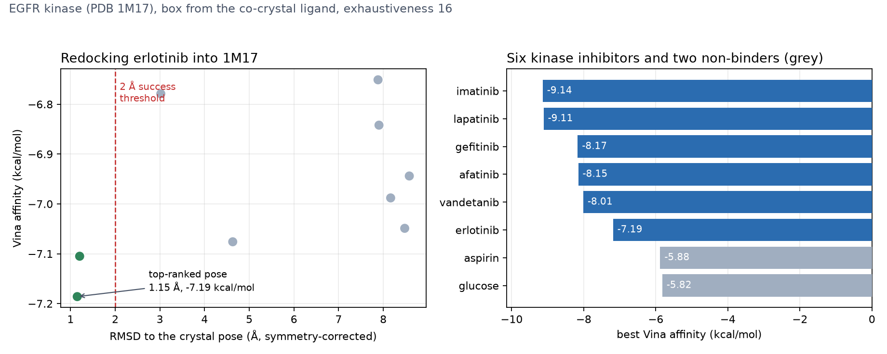

# docking-made-easy

**AutoDock Vina docking you can reproduce: protein preparation, a docking box taken from the co-crystal ligand, batch docking, tidy result tables, and a redocking check that tells you whether any of it can be trusted.**

[](https://github.com/hentablihamza/docking-made-easy/actions/workflows/ci.yml)
[](https://www.python.org)

[AutoDock Vina](https://vina.scripps.edu/) is free, fast and good. Getting from a PDB entry to a result you can defend is the hard part: the receptor has to be stripped, repaired, protonated and typed, the ligand has to be built in 3D with the right charges, and the search box has to sit on the pocket with the right size. Most of the reported failures are setup failures, not Vina failures, and a wrong box still returns a confident-looking score.

`docking-made-easy` does the setup, and makes the one check that matters easy to run: redock the ligand that came with the crystal structure, and measure how far the top pose lands from the experiment.

```bash
# Did my setup work? Redock the co-crystal ligand of 1M17 and measure the RMSD.
dme redock 1M17 --smiles "C#Cc1cccc(Nc2ncnc3cc(OCCOC)c(OCCOC)cc23)c1" --ligand-res AQ4
```

```
Co-crystal ligand: AQ4:A:999 (29 heavy atoms)
Box: center (21.697, 0.303, 52.093) size (24.0 x 12.8 x 15.4) A

ligand  mode  affinity  rmsd_lb  rmsd_ub  rmsd_to_crystal
   AQ4     1    -7.186    0.000    0.000            1.150
   AQ4     2    -7.105    0.956    1.607            1.204
   AQ4     3    -7.076    2.388    4.488            4.630
   ...

Redocking AQ4: PASS
  top pose affinity : -7.19 kcal/mol
  top pose RMSD     : 1.15 A (threshold 2.0 A)
  symmetry-corrected: yes
```

*(Real output. Full run in the [worked example](#worked-example-egfr-kinase-1m17).)*



## The problems, and how docking-made-easy solves them

| # | Problem | What docking-made-easy does |
| --- | --- | --- |
| 1 | **Where do I put the box?** Guessing the centre, or copying numbers from a paper, puts the search in the wrong place | `box_from_ligand()` takes the centre and the size from the co-crystal ligand itself: the pocket is marked experimentally, so use it |
| 2 | **How big?** A box that clips the ligand cannot reproduce the pose; one that swallows the whole protein spreads the search thin | The size is the ligand's own extent plus 4 Å of clearance on every side, raised to a sensible minimum, snapped up to Vina's 0.375 Å grid, and warned about when an edge goes under 10 Å or over 30 Å |
| 3 | **No ligand in the structure?** (apo, or a homology model) | Build the box from a list of pocket residues (`--residues`), or set the centre by hand (`--center`/`--size`), or read it from an existing Vina config |
| 4 | **Is the box actually on the pocket?** | `check_box()` reports what fraction of the ligand is inside, how many receptor heavy atoms are in the box, and warns when the box is sitting in solvent. `--pocket` lists the residues lining the site |
| 5 | **Which HETATM is the ligand?** A PDB entry mixes the ligand with waters, glycerol, sulfate, PEG and ions | Solvent, buffers, cryoprotectants and monoatomic ions are filtered out, candidates are ranked by heavy-atom count, and an ambiguous choice is an error that lists the options, not a silent guess |
| 6 | **Alternate locations and multiple models** silently duplicate atoms | Only the first model and one altloc are kept |
| 7 | **Receptor preparation** needs tools that are hard to install (MGLTools is Python 2) | PDBFixer rebuilds missing heavy atoms and adds hydrogens at a chosen pH, Meeko assigns the AutoDock types, and Open Babel is the automatic fallback. `dme doctor` says exactly what is missing and how to install it |
| 8 | **Meeko refuses a crystal structure** with a cryptic "unable to build rdkit mol for residue …" | The terminal OXT that PDBFixer adds to a ragged chain end is removed (Meeko treats such an end as blunt), missing loops are left unmodelled unless you ask for them, and if Meeko still refuses, the run falls back to Open Babel and says so |
| 9 | **Ligand preparation from SMILES**: 2D coordinates docked as if they were 3D | RDKit ETKDGv3 embedding with a fixed seed and MMFF/UFF optimisation, a simple pH 7.4 model (acids deprotonated, aliphatic amines protonated), then Meeko for the types, Gasteiger charges and rotatable bonds |
| 10 | **One bad SMILES kills a 500-ligand screen** | Ligands are prepared one at a time; failures are collected, named and reported, and the rest of the screen runs. Duplicate names never overwrite each other's files |
| 11 | **Parsing Vina output**: scores live in `REMARK VINA RESULT` lines inside a PDBQT file | `parse_vina_pdbqt()` returns one row per pose (ligand, mode, affinity, rmsd l.b., rmsd u.b.) and `results_table()` merges a whole screen, best ligand first. CSV, TSV or Parquet |
| 12 | **Poses come back as PDBQT**, which most tools will not read as a molecule | Meeko restores the bond orders and the hydrogens, so poses come back as proper SDF or PDB, with the affinity attached as an SD property, and `write_complex()` merges a pose with the receptor for PyMOL |
| 13 | **Was the docking any good?** A score is reported whether or not the setup makes sense | `dme redock` docks the native ligand back into its own structure and reports the symmetry-corrected RMSD to the crystal pose, with the usual 2 Å verdict |
| 14 | **Naive RMSD punishes symmetry**: a chemically identical pose scores 1–2 Å worse because two equivalent atoms were swapped | RMSD is symmetry-corrected (RDKit `CalcRMS`) and computed in place, without alignment, because aligning hides the very error being measured |
| 15 | **Screens are slow** | `dock_many()` runs several ligands at once and divides the cores between them, with progress printed per ligand |
| 16 | **"It works on my machine"** | Every run has an explicit seed, the box is written out as a Vina config, and the settings end up in the result table |

## Installation

**Everything, with conda (recommended, because Vina and PDBFixer come from conda-forge):**

```bash
conda env create -f environment.yml
conda activate docking-made-easy
```

**With pip** (the Python parts; the Vina binary and PDBFixer still come from conda-forge):

```bash
pip install "git+https://github.com/hentablihamza/docking-made-easy.git#egg=docking-made-easy[prep]"
conda install -c conda-forge vina pdbfixer openmm openbabel
```

**For development:**

```bash
git clone https://github.com/hentablihamza/docking-made-easy.git
cd docking-made-easy
pip install -e ".[dev]"
```

Then check the environment:

```bash
dme doctor
```

```
[ok  ] AutoDock Vina (vina)  AutoDock Vina f458505-mod
[ok  ] RDKit  2026.03.1
[ok  ] Meeko  0.8.0
[ok  ] PDBFixer  installed
[ok  ] Meeko receptor prep (mk_prepare_receptor.py)
[ok  ] Open Babel (obabel, fallback)  Open Babel 3.1.0
```

Python 3.10+. The box calculation, the result parsing and the ligand preparation work with RDKit alone; only the docking itself needs the Vina binary.

## Command line

```bash
# 1. What is in this structure?
dme info 1M17                      # a PDB ID (downloaded and cached) or a .pdb file

# 2. The box, from the co-crystal ligand
dme box 1M17 --ligand-res AQ4 --pocket -o box.txt --pymol box.pml
dme box 1M17 --padding 6 --cubic            # more room, cube-shaped
dme box apo.pdb --residues HIS41 CYS145     # no ligand: use pocket residues
dme box apo.pdb --center 12.5 3.0 48.2 --size 22.5   # fully manual

# 3. Receptor
dme prep-receptor 1M17 -o receptor --ph 7.4
dme prep-receptor 6LU7 --keep-residues HEM --keep-ions --chains A

# 4. Ligands
dme prep-ligand "CC(=O)Oc1ccccc1C(=O)O" --name aspirin -o ligands
dme prep-ligand -f library.smi -o ligands

# 5. Dock
dme dock -r receptor/receptor.pdbqt --smiles "C#Cc1cccc(Nc2ncnc3...)c1" \
         --structure 1M17 --ligand-res AQ4 --exhaustiveness 16
dme dock -r receptor/receptor.pdbqt --ligands library.smi --config box.txt \
         --workers 4 --sdf -o results.csv

# 6. Results and validation
dme parse docking/poses/erlotinib_out.pdbqt --csv poses.csv --sdf best.sdf --best-only
dme redock 1M17 --smiles "C#Cc1cccc(Nc2ncnc3cc(OCCOC)c(OCCOC)cc23)c1" --ligand-res AQ4
```

`dme redock` exits 0 when the top pose is within the threshold and 2 when it is not, so it works as a check in a pipeline.

## The box, in detail

This is the part that decides whether a docking run means anything, so it is worth being explicit about what the code does.

Take every **heavy atom of the co-crystal ligand** (hydrogens are often absent from a crystal structure, and including them would bias the size):

| Step | What happens | 1M17 / erlotinib |
| --- | --- | --- |
| extent | the ligand's bounding box, `max - min` on each axis | 15.71 × 4.68 × 7.10 Å |
| centre | the midpoint of that bounding box (`--box-mode centroid` uses the mean atom position instead) | (21.697, 0.303, 52.093) |
| padding | `+4 Å` on **every** side, so `size = extent + 2 × padding` | 23.71 × 12.68 × 15.10 Å |
| minimum | no edge shorter than 12 Å, so a ligand can still rotate | unchanged |
| grid | each edge rounded **up** to a multiple of Vina's 0.375 Å grid spacing | 24.00 × 12.75 × 15.38 Å |

Then it is checked: 100% of the ligand atoms are inside, 148 receptor heavy atoms are inside, and no warning is raised. Write it with `-o box.txt` (a Vina config you can use with plain `vina --config`), `--json-out`, or `--pymol box.pml` to draw the box in PyMOL and look at it.

Two knobs matter:

- **`--padding`** (default 4 Å). Use more when you expect a ligand larger than the crystal one, less when a neighbouring pocket would be swallowed. Padding above ~8 Å usually means you should raise `--exhaustiveness` too.
- **`--box-mode`**. `extent` (default) centres on the bounding box, which is what you want for a normal ligand. `centroid` centres on the mean atom position and then grows the box until every atom still has the full clearance; it differs for a lopsided ligand such as a long tail hanging out of the pocket.

```python
from docking_made_easy import Structure, box_from_ligand, check_box, pocket_residues

structure = Structure.fetch("1M17")
ligand = structure.select_ligand("AQ4")           # the co-crystal ligand
box = box_from_ligand(ligand, padding=4.0)
print(box)                                        # center (21.697, 0.303, 52.093) size (24.0 x 12.8 x 15.4) A
print(check_box(box, ligand, structure.receptor_atoms()))
print(pocket_residues(structure.receptor_atoms(), ligand, cutoff=5.0)[:5])
box.write_config("box.txt")
```

## Python API

```python
from docking_made_easy import (
    Structure, box_from_ligand, prepare_receptor, prepare_ligands,
    dock_many, results_table, save_table, redock,
)

structure = Structure.fetch("1M17")
ligand = structure.select_ligand("AQ4")
box = box_from_ligand(ligand, padding=4.0)

receptor = prepare_receptor("1M17", out_dir="receptor", ph=7.4, structure=structure)
print(receptor.summary())                       # what was removed, added and typed

# Does the setup reproduce the experiment?
check = redock(receptor.pdbqt, ligand, "C#Cc1cccc(Nc2ncnc3cc(OCCOC)c(OCCOC)cc23)c1",
               box, exhaustiveness=16)
assert check.success, check.summary()

# Then screen.
ligands, failures = prepare_ligands("library.smi", out_dir="ligands")
results, failed = dock_many(
    receptor.pdbqt, [(l.name, l.pdbqt) for l in ligands], box,
    out_dir="poses", n_workers=4, exhaustiveness=16, seed=42,
)
save_table(results_table(results), "poses.csv")
print(results[0].ligand, results[0].best_affinity)
```

Every step is also a function on its own: `fetch_pdb`, `split_structure`, `add_hydrogens`, `prepare_ligand`, `dock`, `parse_vina_pdbqt`, `poses_to_sdf`, `pose_to_pdb`, `write_complex`, `rmsd_to_crystal`, `pose_rmsd`.

### The results table

`results_table()` gives one row per pose, ligands ordered by their best affinity:

| ligand | mode | affinity | rmsd_lb | rmsd_ub |
| --- | ---: | ---: | ---: | ---: |
| imatinib | 1 | -9.139 | 0.000 | 0.000 |
| imatinib | 2 | -8.925 | 2.106 | 3.038 |
| lapatinib | 1 | -9.112 | 0.000 | 0.000 |
| … | | | | |

`summary_table()` collapses it to one row per ligand (`best_affinity`, `mean_affinity`, `worst_affinity`, `n_modes`). `affinity` is in kcal/mol and `rmsd_lb`/`rmsd_ub` are Vina's distances from each mode to the best one, in Å, not a distance to anything experimental. That number comes from `redock`.

## Worked example: EGFR kinase (1M17)

[`examples/egfr_1m17_example.py`](examples/egfr_1m17_example.py) runs the whole workflow on the EGFR kinase domain with erlotinib ([PDB 1M17](https://www.rcsb.org/structure/1M17)). Everything below is a real run (AutoDock Vina 1.2.7, Meeko 0.8.0, RDKit 2026.03.1, PDBFixer 1.12, Python 3.11, exhaustiveness 16, seed 42, 24 November 2026), and the outputs are committed in [`examples/egfr_1m17/`](examples/egfr_1m17/).

**Structure.** 2,546 atoms, chain A, 312 residues, 20 waters, one ligand candidate: `AQ4:A:999`, 29 heavy atoms (erlotinib).

**Box.** Centre (21.697, 0.303, 52.093), size 24.00 × 12.75 × 15.38 Å. 100% of the ligand inside, 148 receptor heavy atoms inside. The 20 residues within 5 Å are the ATP site: Leu694, Val702, Ala719, Lys721, Met742, Leu764, Ile765, Thr766, Gln767, Leu768, **Met769**, Pro770, Phe771, Gly772, Cys773, Leu820, Thr830, Asp831, Gly695, Glu738. Met769 is the hinge residue erlotinib hydrogen-bonds to.

**Receptor.** Ligand, 20 waters and the buffer dropped; missing heavy atoms rebuilt; hydrogens added at pH 7.4; typed by Meeko. 3,031 atoms, 534 of them hydrogens. One note: the terminal OXT on the ragged chain end (Pro995) was removed for Meeko compatibility.

**Redocking erlotinib — the sanity check.**

| mode | affinity (kcal/mol) | rmsd l.b. | rmsd u.b. | RMSD to crystal (Å) |
| ---: | ---: | ---: | ---: | ---: |
| **1** | **-7.186** | 0.000 | 0.000 | **1.150** |
| 2 | -7.105 | 0.956 | 1.607 | 1.204 |
| 3 | -7.076 | 2.388 | 4.488 | 4.630 |
| 4 | -7.049 | 3.368 | 8.439 | 8.479 |
| 5 | -6.988 | 3.426 | 8.206 | 8.165 |
| 8 | -6.779 | 1.931 | 3.015 | 3.020 |

The top-ranked pose is **1.15 Å** from the crystal pose, symmetry-corrected and without any alignment, comfortably inside the 2 Å convention: **PASS**. The run took 13.5 s on 8 cores. Note how fast the RMSD degrades below the top two modes while the scores barely move — a 0.1 kcal/mol difference in Vina's score is not a real difference.

**A small screen.** Six kinase inhibitors and two molecules that should not bind a kinase hinge, same receptor and box:

| ligand | best affinity (kcal/mol) | mean | worst |
| --- | ---: | ---: | ---: |
| imatinib | -9.14 | -8.69 | -8.39 |
| lapatinib | -9.11 | -8.66 | -8.39 |
| gefitinib | -8.17 | -7.50 | -7.08 |
| afatinib | -8.15 | -7.79 | -7.35 |
| vandetanib | -8.01 | -7.72 | -7.39 |
| erlotinib | -7.19 | -6.97 | -6.75 |
| aspirin | -5.88 | -5.54 | -5.29 |
| glucose | -5.82 | -5.09 | -4.67 |

Every inhibitor beats both non-binders, which is the separation a usable setup should give. Read it honestly, though: **erlotinib, the native ligand of this structure, ranks sixth of six inhibitors**, and imatinib, which does not inhibit EGFR, ranks first. Vina's score tracks size and buried surface as much as it tracks affinity. Use docking to generate poses and to filter, and keep the ranking for a method that was fit to measure affinity. Whole run: 137 s.

Outputs in [`examples/egfr_1m17/`](examples/egfr_1m17/): `box.txt`, `box.json`, `box.pml`, `redock.csv`, `poses.csv`, `summary.csv`, `report.json`, the prepared receptor, the redocked poses and the best pose as SDF. Regenerate the figure with [`examples/make_figure.py`](examples/make_figure.py).

## Good practice

- **Redock before you screen.** If the native ligand does not come back under 2 Å, nothing downstream is worth reading. Try a larger `--padding`, `--exhaustiveness 32`, `--keep-waters` for a structurally conserved water, or a different protonation.
- **Keep the ligand out of the receptor.** It is removed by default; `--keep-residues` is for cofactors (HEM, NAD, metals in the site), not for the thing you are docking.
- **Raise exhaustiveness for flexible ligands.** The default 8 is a first pass. Above ~10 rotatable bonds, use 32 and compare two seeds: if the top pose moves, the search has not converged.
- **A score is not an affinity.** Vina reports kcal/mol, but the correlation with measured binding is weak. Rank by pose quality and chemistry too.
- **Report everything.** The box, the seed, the exhaustiveness, the Vina version, the protonation pH and the preparation tools belong in the methods section. `report.json` in the example has all of them.
- **Same box for every ligand** in a screen, or the comparison is meaningless.

More on failures: [docs/TROUBLESHOOTING.md](docs/TROUBLESHOOTING.md).

## Testing

```bash
pytest -v
```

101 tests, none of which need the Vina binary or the network, so they run anywhere:

- **Structure parsing**: fields, altlocs, models, elements, selection errors, splitting.
- **The box**: padding, extent vs centroid, grid snapping, minimum and maximum size, cubic boxes, config round-trips, coverage checks, warnings, and the real 1M17 box reproduced to three decimals from committed crystal coordinates.
- **Ligand preparation**: SMILES validation, reproducible embedding, protonation, PDBQT contents, SMI/CSV/SDF reading, duplicate names, and failures that skip rather than stop.
- **Result parsing**: a real Vina output file, the stdout table, tables, export formats, complex building.
- **Redocking maths**: symmetry-corrected RMSD, translation detection, mismatched molecules, and the committed 1M17 redocking fixture checked against its 1.15 Å result.
- **The docking runner**: command construction, settings validation, missing or empty files, missing tools.
- **The CLI**: every subcommand that does not need Vina.

CI runs the suite on Python 3.10 and 3.12, plus a CLI smoke test, and then verifies that the committed example outputs are internally consistent and that the committed box is exactly what the code computes from the crystal coordinates ([`examples/check_example_outputs.py`](examples/check_example_outputs.py)).

The docking itself — receptor preparation, Vina runs, the redocking RMSD — is run **locally**, not in CI: Vina, PDBFixer, OpenMM and Open Babel are large conda-forge binaries, and a GitHub runner would spend most of its time installing them. The real run is committed instead, numbers and all, so you can check it.

## Project layout

```
src/docking_made_easy/
  structure.py   PDB parsing, ligand/water/ion splitting, RCSB download + cache
  box.py         the docking box: from a ligand, from residues, or manual; checks
  receptor.py    PDB -> receptor PDBQT (PDBFixer + Meeko, Open Babel fallback)
  ligand.py      SMILES/SDF -> 3D -> PDBQT (RDKit ETKDGv3 + Meeko), batch prep
  dock.py        Vina command building, single and parallel runs
  results.py     Vina output -> tidy tables, SDF/PDB poses, receptor+pose complexes
  validate.py    redocking and symmetry-corrected RMSD to the crystal pose
  tools.py       external-tool detection and install hints (dme doctor)
  cli.py         the dme command
examples/egfr_1m17_example.py    the worked example (outputs in examples/egfr_1m17/)
examples/check_example_outputs.py  consistency check run in CI
docs/TROUBLESHOOTING.md          what to do when docking goes wrong
```

## Data attribution

The structure used in the example is [PDB 1M17](https://www.rcsb.org/structure/1M17) (Stamos, Sliwkowski & Eigenbrot, *J. Biol. Chem.* 2002, 277, 46265–46272, doi:[10.1074/jbc.M207135200](https://doi.org/10.1074/jbc.M207135200)), downloaded from the RCSB PDB. The coordinates in `examples/egfr_1m17/` and in `tests/fixtures/mini_complex.pdb` are derived from that entry; the test fixture is a trimmed copy of the pocket, with one synthetic zinc ion added so the ion-filtering code has something to filter.

`docking-made-easy` is an independent project, not affiliated with the Scripps Research Institute, the AutoDock developers or the RCSB PDB. If you use it, cite AutoDock Vina:

> Eberhardt J., Santos-Martins D., Tillack A.F., Forli S. AutoDock Vina 1.2.0: New Docking Methods, Expanded Force Field, and Python Bindings. *J. Chem. Inf. Model.* 2021, 61(8), 3891–3898. doi:[10.1021/acs.jcim.1c00203](https://doi.org/10.1021/acs.jcim.1c00203)
>
> Trott O., Olson A.J. AutoDock Vina: improving the speed and accuracy of docking with a new scoring function, efficient optimization, and multithreading. *J. Comput. Chem.* 2010, 31(2), 455–461. doi:[10.1002/jcc.21334](https://doi.org/10.1002/jcc.21334)

Meeko and RDKit do the preparation; please cite them too if they do the work for your paper.

## Citation

If `docking-made-easy` helps your research, please cite it with the metadata in [`CITATION.cff`](CITATION.cff) (GitHub's "Cite this repository" button).

## Related repositories

- [chembl-easy](https://github.com/hentablihamza/chembl-easy) — clean, ML-ready bioactivity data from ChEMBL. Its EGFR table is a natural ligand set for a screen.
- [chem-curate](https://github.com/hentablihamza/chem-curate) — reproducible curation of chemical structures and bioactivity data.
- [qsar-split-bench](https://github.com/hentablihamza/qsar-split-bench) — how much a random split overstates a QSAR model.
- [practical-cheminformatics-course](https://github.com/hentablihamza/practical-cheminformatics-course) — 12 Colab notebooks, RDKit to QSAR.
- [practical-molecular-dynamics-course](https://github.com/hentablihamza/practical-molecular-dynamics-course) — 12 Colab notebooks, OpenMM from first principles. A natural next step after docking: refine a pose with MD.
- [practical-biopython-course](https://github.com/hentablihamza/practical-biopython-course) — 12 Colab notebooks, sequences to structures.

## Author

**Hamza Hentabli, Ph.D.**, AI/ML drug discovery and cheminformatics
[Google Scholar](https://scholar.google.com/citations?user=-7dUlnMAAAAJ) · [ORCID](https://orcid.org/0000-0002-9530-2815) · [LinkedIn](https://www.linkedin.com/in/hentabli-hamza-ph-d-99192a101) · [GitHub](https://github.com/hentablihamza)
